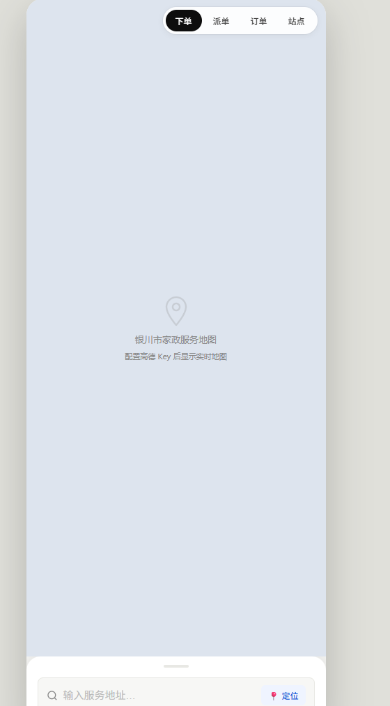
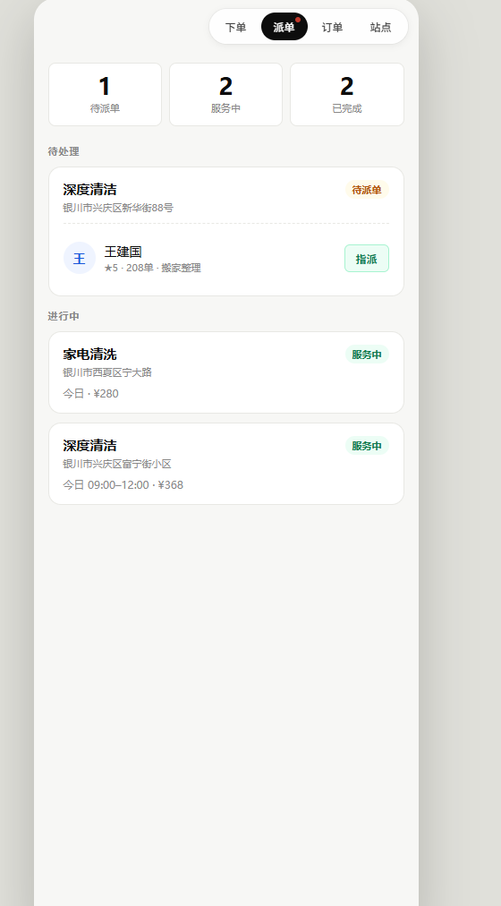
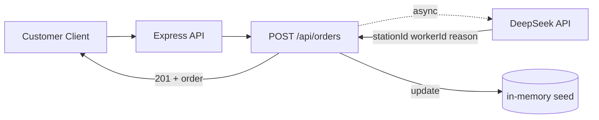
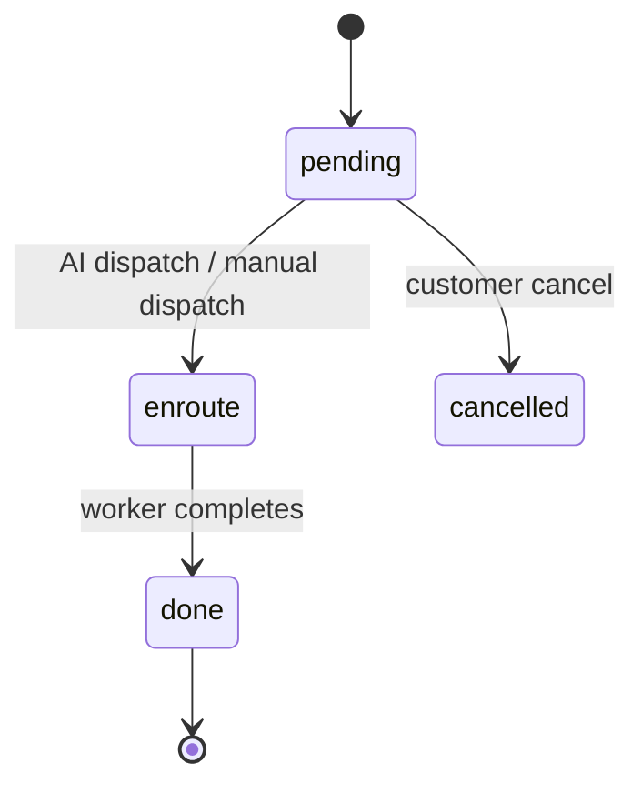

# Enterprise AI Dispatch Platform


[](https://github.com/zihanxu330/enterprise-dispatch-platform/actions/workflows/ci.yml)

A full-stack **order dispatch management system** for service enterprises: customers place orders, and an **LLM dispatch engine** automatically routes each order to the optimal station and worker — balancing distance, service rating, and skill match. Built as a complete order lifecycle: **create → dispatch → complete**.

> 家政速派调度系统：用户在网页下单，DeepSeek AI 引擎结合站点距离、工人评分与技能匹配，自动完成派单。

---

## ✨ Features

- **LLM-powered dispatch decision**: DeepSeek (`deepseek-chat`, temperature 0.2 for stable output) picks the best station & worker from candidate stations (distance, ETA, rating, skill, completed orders) and returns a dispatch rationale
- **Complete order lifecycle**: create → dispatch → complete, plus cancel and review (1-5 rating updates worker average)
- **Geolocation**: Haversine distance + AMap integration for finding the nearest station
- **Graceful AI degradation**: if the LLM call fails, the order stays `pending` and manual dispatch remains available — order creation never blocks on AI
- **Secure by design**: all API keys injected via environment variables, `.env` git-ignored
- **One-command start**: `docker compose up` (in-memory demo data, no database setup needed)

## 📸 Screenshots

| Customer | Dispatch result |
| --- | --- |
|  |  |

> *Screenshots to be added — place PNG files in `docs/images/` (≤500KB each, demo data only).*

## 🏗 Tech Stack

| Layer | Technology |
| --- | --- |
| Backend | Node.js (≥18) · Express |
| Frontend | Static HTML + JavaScript (fetch → REST API) |
| AI Engine | DeepSeek API (`deepseek-chat`) |
| Geolocation | AMap (AutoNavi) / Haversine |
| Data | In-memory seed (`data/seed.js`; MySQL planned) |
| Ops | Docker Compose · GitHub Actions CI |

## 🧱 Architecture



Order state flow:



See [docs/architecture.md](docs/architecture.md) for the full request flow and degradation design.

## 📁 Project Structure

```
enterprise-dispatch-platform/
├── backend/                  ← Node.js + Express backend
│   ├── server.js             ← main entry, port 3000
│   ├── package.json
│   ├── Dockerfile
│   ├── middlewares/          ← errorHandler + asyncHandler
│   ├── data/seed.js          ← initial data (stations, orders, pricing)
│   ├── routes/
│   │   ├── orders.js         ← order CRUD + dispatch + review
│   │   ├── stations.js       ← station queries + nearest lookup
│   │   └── config.js         ← pricing, service types
│   ├── services/deepseek.js  ← AI dispatch engine (key from env)
│   └── test/smoke.js         ← black-box API smoke tests
├── frontend/                 ← static frontend
│   ├── index.html            ← UI structure + CSS
│   └── app.js                ← interaction logic (fetch → API)
├── docs/
│   ├── api.md                ← full API reference
│   ├── architecture.md       ← layering + request flow + state machine
│   ├── test-cases.md         ← 21 black/white-box test cases
│   └── images/               ← screenshots
├── .github/workflows/ci.yml  ← CI: install + lint + smoke test
├── docker-compose.yml        ← one-command start
├── .env.example
├── .gitignore
├── LICENSE
└── README.md
```

## 🚀 Quick Start

### Option A — Docker Compose (recommended)

```bash
git clone https://github.com/zihanxu330/enterprise-dispatch-platform.git
cd enterprise-dispatch-platform
cp .env.example .env          # fill in DEEPSEEK_API_KEY (optional)
docker compose up
```

Open http://localhost:3000 — no database or Node.js setup needed.

### Option B — Local (Node.js ≥ 18)

```bash
cd backend
npm install
cp ../.env.example ../.env    # fill in DEEPSEEK_API_KEY (optional)
npm start
```

Backend prints `✅ 家政速派后端已启动：http://localhost:3000`; open http://localhost:3000.

### Option C — CLI test

```bash
cd backend
npm test                      # runs the 6-case smoke suite
```

## 📡 API Overview

| Method | Path | Description |
| --- | --- | --- |
| GET | /api/orders | List all orders |
| POST | /api/orders | Create an order (async AI dispatch) |
| PUT | /api/orders/:id/dispatch | Dispatch order to a worker |
| PUT | /api/orders/:id/complete | Complete an order |
| DELETE | /api/orders/:id | Cancel a pending order |
| POST | /api/orders/:id/review | Rate a completed order (1-5) |
| GET | /api/stations | List all stations |
| GET | /api/stations/nearest?lat=&lng= | Find nearest station |
| GET | /api/config | Get pricing / service types |

Full reference: [docs/api.md](docs/api.md)

## 👥 My Contribution

Team project (5 members) — **I was responsible for the client-side frontend and the backend**: [fill in 3-4 concrete items, e.g. "designed the order REST API", "implemented the DeepSeek dispatch service", "wrote docs + smoke tests"].

## 📚 Documentation

- [API reference](docs/api.md)
- [Architecture](docs/architecture.md)
- [Test cases](docs/test-cases.md)

## ❓ FAQ

- **Order created but never dispatched?** Check the backend log for `[AI派单] 失败` — this means the DeepSeek call failed (missing/expired key, or no available worker). Use manual dispatch (`PUT /api/orders/:id/dispatch`) as fallback.
- **Missing DEEPSEEK_API_KEY warning?** Copy `.env.example` to `.env` and fill in your key. AI dispatch is disabled without it, but manual dispatch still works.
- **Data resets on restart?** Yes — demo data is in-memory by design. MySQL persistence is on the roadmap.
- **Port already in use?** Set `PORT` in `.env`.

## 🗺 Roadmap

- [x] AI dispatch engine (DeepSeek) with graceful degradation
- [x] Unified error handling + env validation
- [x] Docker Compose + CI smoke tests
- [x] Docs: API reference, architecture, test cases
- [ ] MySQL persistence (connection pool) + `docs/schema.sql`
- [ ] Multi-role auth: user / station / enterprise (JWT, bcrypt)
- [ ] Vue3 frontend upgrade
- [ ] Request validation (joi/zod) + rate limiting

## 🔒 Security Notes

- All API keys are injected via environment variables; `.env` is git-ignored — never commit real keys
- AI logs never include full request bodies or keys
- SQL (once MySQL is added) must use parameterized queries only

## 📄 License

[MIT](LICENSE)
