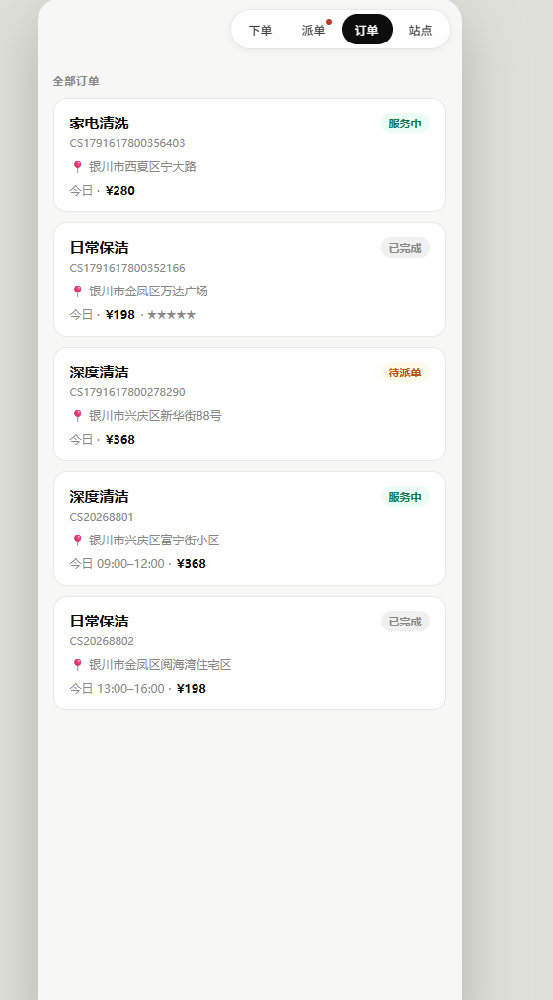
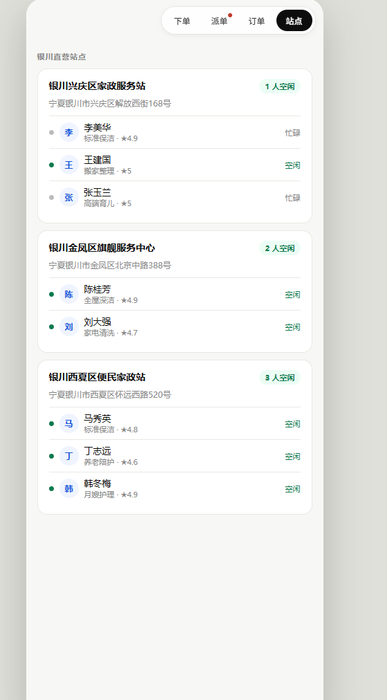
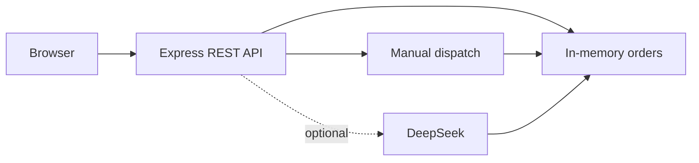

# Enterprise Dispatch Platform · 家政速派

**一个展示订单生命周期的全栈调度应用。** 用户创建订单，调度员选择站点与工人，完成服务后记录评价；可选接入 DeepSeek 辅助派单。

A local full-stack demo of order creation, dispatch, completion and review, built with Node.js, Express and plain JavaScript.

[界面预览](#screenshots) · [本地运行](#quick-start) · [API 文档](docs/api.md) · [MIT License](LICENSE)

## Screenshots

| 用户下单 | 派单工作台 |
| --- | --- |
|  |  |

| 订单列表 | 站点与工人 |
| --- | --- |
|  |  |

## Features

- 订单创建、人工派单、完结、取消和服务评价。
- 使用站点坐标计算 Haversine 距离，展示候选站点。
- 可选 DeepSeek 辅助派单，返回候选站点、工人和理由。
- 无 API Key 时使用人工派单，不发送模型请求。
- 内存演示数据，启动无需配置数据库；重启后恢复初始数据。

## Quick start

### Local · Node.js 18+

```bash
git clone https://github.com/zihanxu330/enterprise-dispatch-platform.git
cd enterprise-dispatch-platform/backend
npm ci
npm start
```

打开 [http://localhost:3000](http://localhost:3000)。无需 API Key 即可体验人工派单。

启用 AI 派单时，在启动服务的终端设置 `DEEPSEEK_API_KEY`。PowerShell 示例：

```powershell
$env:DEEPSEEK_API_KEY = "your-api-key"
npm start
```

本地 Node 启动读取进程环境变量；Docker Compose 则从仓库根目录的 `.env` 读取配置。

### Docker Compose

在仓库根目录，将 `.env.example` 复制为 `.env`，不使用 AI 时将 Key 留空。

```bash
docker compose up --build
```

同样访问 [http://localhost:3000](http://localhost:3000)。

## Request flow



订单状态：`pending → enroute → done`；待派单订单可以转为 `cancelled`。模型调用失败时，订单保持待派单状态。

## Development

从 `backend/` 运行：

```bash
npm test
```

冒烟检查使用本地服务和演示数据，不请求 DeepSeek。

| 目录 | 内容 |
| --- | --- |
| `backend/routes/` | 订单、站点与配置 API |
| `backend/services/` | DeepSeek 客户端 |
| `backend/data/seed.js` | 站点、工人和订单演示数据 |
| `frontend/` | HTML、CSS 与 JavaScript 界面 |
| `docs/` | API、架构与测试用例 |

## Project context

这是一个五人课程团队项目。我负责客户端前端与后端相关实现，项目用于展示业务流程、API 集成与工程实践。

## Scope

- 当前是本地演示应用，未实现用户认证、角色权限或数据库持久化。
- AI 提供候选派单建议，不保证全局最优；实际业务需增加人工审核与约束。
- 当前站点距离使用直线距离近似，不等于实际道路距离或实时交通 ETA。
- 外部模型集成需要单独配置并验证；自动检查覆盖本地流程。

[API reference](docs/api.md) · [Architecture](docs/architecture.md) · [Test cases](docs/test-cases.md)

Licensed under [MIT](LICENSE).
