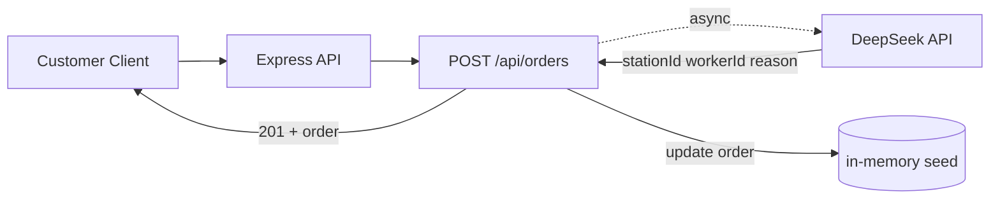
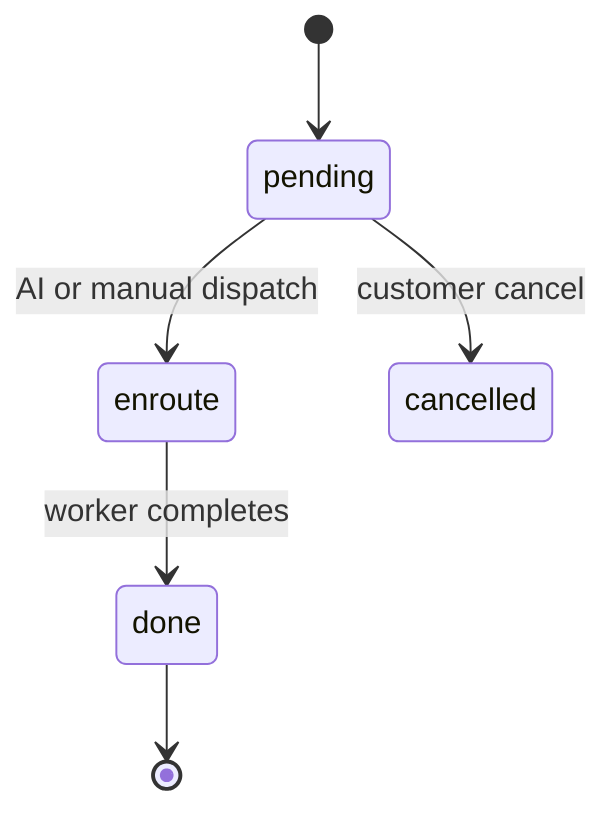

# Architecture

## Overview

The system is a single-server full-stack platform: a static frontend served by Express, a REST API, in-memory data (seeded on startup), and an asynchronous AI dispatch engine backed by the DeepSeek chat API.

## Layering

```
frontend/            static HTML + JS (customer flow)
   │  fetch (REST)
   ▼
backend/
   ├── server.js            Express app, static hosting, route mounting
   ├── routes/              HTTP layer: parse input, call services, respond
   │   ├── orders.js        order CRUD + manual dispatch + review
   │   ├── stations.js      station queries + nearest lookup
   │   └── config.js        pricing / service types
   ├── services/deepseek.js AI dispatch engine (external LLM call)
   └── data/seed.js         in-memory seed data (stations, workers, orders)
```

## Request flow (create order + AI dispatch)



1. Customer submits order form → `POST /api/orders`
2. Route validates required fields (`type`, `addr`), creates order, stores in memory, returns `201`
3. In the background, the server computes each station's distance (Haversine) and ETA
4. `services/deepseek.js` asks DeepSeek to pick the best station + worker from available candidates
5. If the AI call succeeds and the chosen worker is still available, the order transitions `pending → enroute`
6. If the AI call fails, the order stays `pending` and the customer can still be served by manual dispatch — graceful degradation

## State machine



## Key decisions

- **AI degradation**: the AI call is wrapped in try/catch; failure is logged and never blocks order creation. Manual dispatch (`PUT /api/orders/:id/dispatch`) is always available as fallback.
- **Data layer**: in-memory for demonstration. For production, replace `data/seed.js` with MySQL (connection pool) while keeping the route/controller shape.
- **Secrets**: all keys come from environment variables (`.env`), never committed.
- **Frontend static hosting**: Express serves `frontend/` in dev; production can move static files to nginx.
